<p align="center">
  
</p>

<h1 align="center">Building practical tools for stronger security operations</h1>

<p align="center">
  Threat Intelligence · SIEM &amp; Detection Engineering · Incident Response · AI-Assisted SOC · AI-Ready Frameworks
</p>

<p align="center">
  <a href="https://www.linkedin.com/in/amitmilindambekar/"></a>
  <a href="https://portfolio.thesafehouse.in"></a>
  <a href="https://blog.thesafehouse.in"></a>
  <a href="#live-websites"></a>
  <a href="mailto:amit.ambekar@protonmail.com"></a>
</p>

<p align="center">
  <a href="#ai-ready-open-projects">AI-ready projects</a> ·
  <a href="#featured-projects">Featured projects</a> ·
  <a href="#project-directory">All projects</a> ·
  <a href="#live-websites">Live websites &amp; Academy</a> ·
  <a href="#threat-intelligence-feeds">IOC feeds</a> ·
  <a href="#security-toolkit">Security toolkit</a> ·
  <a href="#credentials-and-learning">Credentials</a>
</p>

## About me

I'm **Amit Ambekar**, a cyber defense architect and threat intelligence researcher building practical tools and frameworks for security operations teams. My work connects **threat intelligence, detection engineering, incident investigation, and automation** — and, more and more, **AI-ready projects that anyone can pick up and use**.

I focus on making security knowledge usable: enriching indicators, structuring investigations, documenting SOC operations, and helping analysts move from an alert to an informed decision. Through **The Safehouse** I share practical cybersecurity knowledge, and **The Safehouse Academy** is launching soon with a **Cyber Security &amp; Audit Ready Course**.

| | What I build |
| :-: | :--- |
| 🔎 | **Threat intelligence** — IOC enrichment, public indicator feeds, dark-web monitoring plans |
| 🛡️ | **Detection &amp; response** — MITRE ATT&amp;CK-mapped Elastic rules, ELK incident-response playbooks, SIEM dashboards |
| 🤖 | **AI-ready frameworks** — open projects where an AI assistant guides you to a finished report, roster, handbook, or plan |
| 🏛️ | **Compliance-aware SOC resources** — CERT-In, SEBI CSCRF, RBI, DPDP, ISO/IEC 27001 and 42001 context |
| 🎓 | **Learning** — SOC career guidance today, and The Safehouse Academy soon |

<p align="center">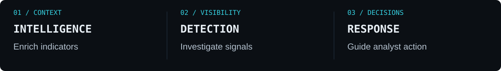</p>

## AI-assisted SOC terminal — live preview

<picture>
  <source media="(prefers-color-scheme: dark)" srcset="./assets/soc-terminal-dark.svg">
  <source media="(prefers-color-scheme: light)" srcset="./assets/soc-terminal-light.svg">
  
</picture>

<p align="center">A closer look at the terminal-style workflow behind the <strong>SOC Nemotron Workbench &amp; CLI</strong> — auto-switches with your GitHub theme.</p>

## AI-ready open projects

Several of my projects are built to work **with your AI assistant**. Point an assistant that can read GitHub files at a repository, answer its guided questions, and receive a ready-to-review deliverable — a PDF report, a SOC roster, a customized handbook, an adoption plan, or a personal study path. They are free for everyone to use: **just add AI and start.**

<p align="center"></p>

| Project | Your AI assistant helps you produce |
| :--- | :--- |
| 📊 [AnySIEM-Reports](https://github.com/amitambekar510/AnySIEM-Reports) | A branded PDF report from 38 SOC report templates<br/>👉 [AI_INSTRUCTIONS.md](https://github.com/amitambekar510/AnySIEM-Reports/blob/main/AI_INSTRUCTIONS.md) |
| 🛰️ [MSP Sentinel AI](https://github.com/amitambekar510/msp-sentinel-ai) | An infrastructure-specific adoption plan for an MSP SOC<br/>👉 [AI_INSTRUCTIONS.md](https://github.com/amitambekar510/msp-sentinel-ai/blob/main/AI_INSTRUCTIONS.md) |
| 🗓️ [ShiftGuard](https://github.com/amitambekar510/ShiftGuard-SOC-Roster-Management) | A reviewed monthly SOC roster with coverage gaps disclosed<br/>👉 [AI_INSTRUCTIONS.md](https://github.com/amitambekar510/ShiftGuard-SOC-Roster-Management/blob/main/AI_INSTRUCTIONS.md) |
| 📘 [SOC Operations Handbook](https://github.com/amitambekar510/soc-operations-handbook) | A complete 21-section SOC handbook for your organization<br/>👉 [AI Builder guide](https://github.com/amitambekar510/soc-operations-handbook/blob/main/ai-builder/README.md) |
| 🧭 [SOC Career Launchpad](https://github.com/amitambekar510/SOC-Career-Launchpad) | A personal SOC learning path with a strict AI tutor<br/>👉 [AI tutor setup](https://github.com/amitambekar510/SOC-Career-Launchpad/blob/main/ai/README.md) |
| ⌨️ [SOC Nemotron CLI](https://github.com/amitambekar510/SOC-Nemotron-CLI) | AI-assisted investigations from your terminal<br/>👉 [Operating guide](https://github.com/amitambekar510/SOC-Nemotron-CLI) |

<details>
<summary><strong>📋 Copy-paste starter prompts</strong></summary>

**AnySIEM-Reports**

```text
Read AI_INSTRUCTIONS.md in the repository
https://github.com/amitambekar510/AnySIEM-Reports
and follow it exactly. Start by showing me the template catalog.
```

**MSP Sentinel AI**

```text
Read AGENTS.md and AI_INSTRUCTIONS.md from this repository.
Ask me one question at a time, starting with which SIEM I use.
Do not ask for secrets or assume customer integrations are live.
```

**ShiftGuard**

```text
Read AI_INSTRUCTIONS.md from the ShiftGuard-SOC-Roster-Management
GitHub repository. First ask me for names and roles of General-shift
priority staff, then names and roles of rotating SOC analysts.
```

No GitHub access in your assistant? Download the repository ZIP, attach it, and use the same prompt.

</details>

> **Use responsibly:** these are AI-assisted frameworks, not hosted services. Review every output, never paste secrets or customer data into prompts, and check each repository's license — terms differ between projects (for example MIT for ShiftGuard and SOC Career Launchpad, custom open-use terms for the Handbook and AnySIEM-Reports).

## Featured projects

**Choose a starting point:** generate an AI-guided report, plan an MSP SOC, build a roster, draft a SOC handbook, learn the SOC path, or enrich and investigate indicators.

### 🤖 AI-ready frameworks

<h3>📊 AnySIEM-Reports</h3>
<p><strong>AI-guided SOC reporting for any SIEM</strong></p>
<p align="center"><a href="https://github.com/amitambekar510/AnySIEM-Reports"></a></p>
<p>Choose from <strong>38 report blueprints</strong> across operations, incident response, threat intelligence, governance, exposure, and managed-service reporting. Answer guided questions about your SOC and your AI assistant helps turn approved evidence into a polished PDF.</p>
<p>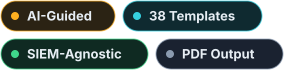</p>
<p><a href="https://github.com/amitambekar510/AnySIEM-Reports"></a>&nbsp;&nbsp;<a href="https://github.com/amitambekar510/AnySIEM-Reports/blob/main/catalog/templates.yaml"></a>&nbsp;&nbsp;<a href="https://github.com/amitambekar510/AnySIEM-Reports/blob/main/AI_INSTRUCTIONS.md"></a></p>

> 🧪 **Note:** Illustrative walkthrough, not a live application. Inputs and regulatory claims always need human review.

<hr />

<h3>🛰️ MSP Sentinel AI 3.0</h3>
<p><strong>AI-guided infrastructure intake, public CTI fusion, and a multi-tenant SOC demonstration</strong></p>
<p align="center"><a href="https://github.com/amitambekar510/msp-sentinel-ai"></a></p>
<p>Tell an AI assistant about your SIEM, tenants, telemetry, and controls — one question at a time — and receive an infrastructure-specific adoption plan that separates what is implemented from what production still needs.</p>
<p>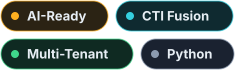</p>
<p><a href="https://github.com/amitambekar510/msp-sentinel-ai"></a>&nbsp;&nbsp;<a href="https://github.com/amitambekar510/msp-sentinel-ai/blob/main/AI_INSTRUCTIONS.md"></a></p>

> 🧪 **Note:** Demo tenants and data are synthetic. This is not a compliance certificate; production use requires your own validation.

<hr />

<h3>🗓️ ShiftGuard 4.0</h3>
<p><strong>AI-ready SOC workforce studio for 24/7 rosters</strong></p>
<p align="center"><a href="https://github.com/amitambekar510/ShiftGuard-SOC-Roster-Management"></a></p>
<p>Build monthly SOC rosters with general-shift priority and coverage diagnostics. Use an AI assistant to collect names and roles, or run the local guided wizard — everything stays local-first, with Excel export.</p>
<p></p>
<p><a href="https://github.com/amitambekar510/ShiftGuard-SOC-Roster-Management"></a>&nbsp;&nbsp;<a href="https://amitambekar510.github.io/ShiftGuard-SOC-Roster-Management/"></a></p>

> 🧪 **Note:** Illustrative animation using fictional analysts, not real SOC staffing data.

<hr />

<h3>📘 SOC Operations Handbook</h3>
<p><strong>A 21-section, SIEM-agnostic handbook with an AI builder</strong></p>
<p align="center"><a href="https://github.com/amitambekar510/soc-operations-handbook">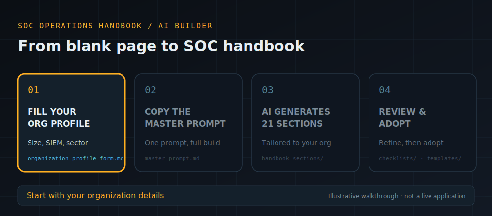</a></p>
<p>Stop writing SOC documentation from scratch. Fill in an organization profile, hand the master prompt to your AI tool, and generate a handbook customized to your SOC — with templates, checklists, and Indian regulatory coverage (CERT-In, SEBI CSCRF, RBI, DPDP).</p>
<p></p>
<p><a href="https://github.com/amitambekar510/soc-operations-handbook"></a>&nbsp;&nbsp;<a href="https://github.com/amitambekar510/soc-operations-handbook/blob/main/ai-builder/README.md"></a>&nbsp;&nbsp;<a href="https://amitambekar510.github.io/soc-operations-handbook"></a></p>

> 🧪 **Note:** Illustrative walkthrough, not a live application. Review generated content before adopting it.

<hr />

<h3>🧭 SOC Career Launchpad</h3>
<p><strong>A plain-English guide to starting a SOC career — with an AI tutor mode</strong></p>
<p align="center"><a href="https://github.com/amitambekar510/SOC-Career-Launchpad">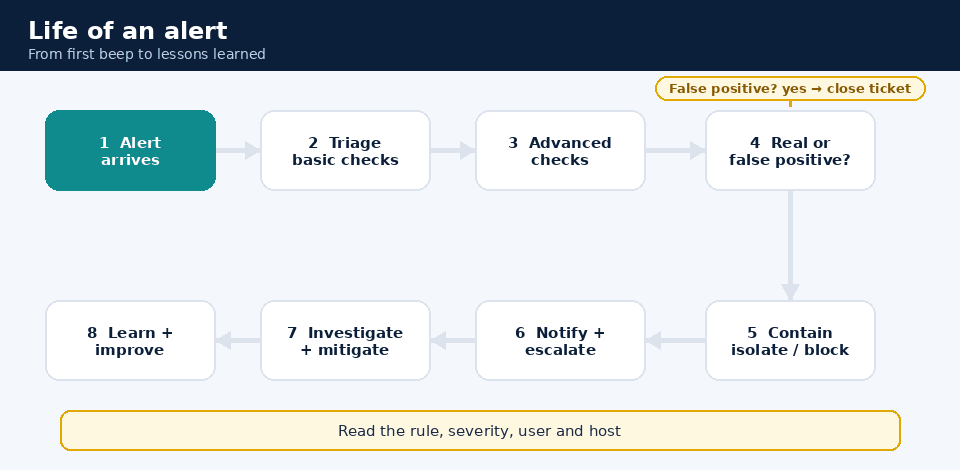</a></p>
<p>A beginner-friendly roadmap (networking, Linux, security fundamentals, attacks, alert handling, SIEM/EDR tools, interview prep, regulations) with an 8-week study plan. Connect an AI assistant and it becomes a tutor that asks first and tracks your progress.</p>
<p></p>
<p><a href="https://github.com/amitambekar510/SOC-Career-Launchpad"></a>&nbsp;&nbsp;<a href="https://github.com/amitambekar510/SOC-Career-Launchpad/blob/main/ai/README.md"></a></p>

> 📚 **Note:** One of several animated lessons in the repository.

<hr />

<h3>🧱 Universal SIEM Dashboard Framework v2.0</h3>
<p><strong>14 vendor-neutral dashboard designs for threat hunting, compliance, and AI security</strong></p>
<p align="center"><a href="https://github.com/amitambekar510/siem-dashboard-framework"></a></p>
<p>Dashboard designs mapped to 8 frameworks and regulations, with new ISO/IEC 27090 (AI threats) and ISO/IEC 42001 (AI management) coverage, an <code>ai.*</code> telemetry schema, and hunt playbooks — for any SIEM.</p>
<p>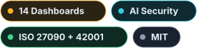</p>
<p><a href="https://github.com/amitambekar510/siem-dashboard-framework"></a>&nbsp;&nbsp;<a href="https://github.com/amitambekar510/siem-dashboard-framework/blob/main/docs/dashboard-catalog.md"></a>&nbsp;&nbsp;<a href="https://amitambekar510.github.io/siem-dashboard-framework/"></a></p>

> 🧪 **Note:** Demo visuals are synthetic and watermarked, with no real production or client data.

<hr />

### 🛠️ Core security engineering

<table>
<tr>
<td width="50%" valign="top">
<a href="https://github.com/amitambekar510/ioc-enrichment-console">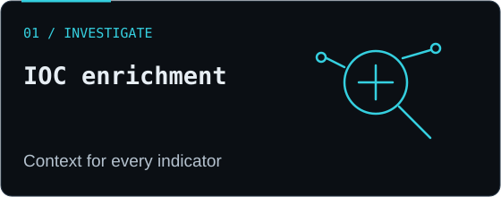</a>
<h3>🔎 IOC Enrichment Console</h3>
<p>Investigate IPs, domains, and SHA256 hashes with multi-source enrichment, visual dashboards, and exportable reports.</p>
<p><strong>Next.js · Flask · Threat intelligence APIs</strong></p>
<p><a href="https://github.com/amitambekar510/ioc-enrichment-console">Explore the console →</a></p>
</td>
<td width="50%" valign="top">
<a href="https://github.com/amitambekar510/cti-automation-chain">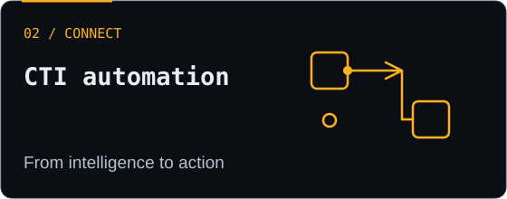</a>
<h3>⚡ CTI Automation Chain</h3>
<p>Connect intelligence analysis, detection engineering, automation workflows, and response reporting in a staged pipeline.</p>
<p><strong>Python · Feedly CTI prompts · OpenCode</strong></p>
<p><a href="https://github.com/amitambekar510/cti-automation-chain">Explore the pipeline →</a></p>
</td>
</tr>
<tr>
<td width="50%" valign="top">
<a href="https://github.com/amitambekar510/elk-ir-playbooks">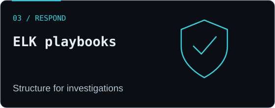</a>
<h3>🛡️ ELK Incident Response Playbooks</h3>
<p>Structured investigation and response resources covering endpoint, identity, network, cloud, and threat intelligence scenarios.</p>
<p><strong>Elastic / ELK · YAML · Incident response</strong></p>
<p><a href="https://github.com/amitambekar510/elk-ir-playbooks">Explore the playbooks →</a></p>
</td>
<td width="50%" valign="top">
<a href="https://github.com/amitambekar510/SOC-Nemotron-CLI">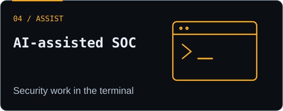</a>
<h3>⌨️ SOC Nemotron Workbench &amp; CLI</h3>
<p>Prepare investigation prompts in a local browser workbench with guided inputs, sample data, prompt preview, copy, and Markdown download. Use reviewed prompts through OpenCode for AI-assisted investigations.</p>
<p><strong>Python · Browser workbench · OpenCode · NVIDIA Nemotron</strong></p>
<p><a href="https://github.com/amitambekar510/SOC-Nemotron-CLI">Explore the CLI →</a> · <a href="https://github.com/amitambekar510/SOC-Nemotron-CLI-Linux">Linux</a> · <a href="https://github.com/amitambekar510/SOC-Nemotron-CLI-Windows">Windows</a></p>
</td>
</tr>
</table>

## Project directory

<details open>
<summary><strong>🗂️ Browse all 21 public security projects by purpose</strong> &nbsp;·&nbsp; 🆕 = recently added</summary>

**🤖 AI-ready frameworks**

| Project | What it provides |
| :--- | :--- |
| 🆕 📊 [AnySIEM-Reports](https://github.com/amitambekar510/AnySIEM-Reports) | 38 SIEM-agnostic report templates with guided AI workflow and PDF output<br/><sub>🏷️ AI-guided framework</sub> |
| 🆕 🛰️ [MSP Sentinel AI](https://github.com/amitambekar510/msp-sentinel-ai) | AI-guided intake, public CTI fusion, and a multi-tenant synthetic SOC demo<br/><sub>🏷️ Python app + AI guide</sub> |
| 🆕 🗓️ [ShiftGuard](https://github.com/amitambekar510/ShiftGuard-SOC-Roster-Management) | 24/7 SOC roster generation with coverage diagnostics and Excel export<br/><sub>🏷️ Python CLI + web studio</sub> |
| 🆕 📘 [SOC Operations Handbook](https://github.com/amitambekar510/soc-operations-handbook) | 21 handbook sections, templates, checklists, and an AI builder<br/><sub>🏷️ Documentation framework</sub> |
| 🆕 🧭 [SOC Career Launchpad](https://github.com/amitambekar510/SOC-Career-Launchpad) | Beginner SOC roadmap, 8-week plan, quizzes, and AI tutor mode<br/><sub>🏷️ Learning guide</sub> |
| ⌨️ [SOC Nemotron Workbench & CLI](https://github.com/amitambekar510/SOC-Nemotron-CLI) | Local prompt preparation for IOC extraction, detection drafts, and investigations<br/><sub>🏷️ Browser workbench + guide</sub> |
| 🐧 [SOC Nemotron — Linux](https://github.com/amitambekar510/SOC-Nemotron-CLI-Linux) | Linux setup guidance and operational prompt templates<br/><sub>🏷️ Platform guide</sub> |
| 🪟 [SOC Nemotron — Windows](https://github.com/amitambekar510/SOC-Nemotron-CLI-Windows) | Windows, PowerShell, and WSL2 guidance for AI-assisted SOC workflows<br/><sub>🏷️ Platform guide</sub> |

**🔎 Threat intelligence &amp; enrichment**

| Project | What it provides |
| :--- | :--- |
| 🔬 [IOC Enrichment Console](https://github.com/amitambekar510/ioc-enrichment-console) | Multi-source enrichment for IPs, domains, and hashes, with streamed results, maps, and report exports<br/><sub>🏷️ Next.js + Flask application</sub> |
| ⚡ [CTI Automation Chain](https://github.com/amitambekar510/cti-automation-chain) | Staged intelligence analysis, detection engineering, automation, and response reporting<br/><sub>🏷️ Python workflow project</sub> |
| 🕸️ [SOC DarkWatch](https://github.com/amitambekar510/SOC-DarkWatch) | Phased planning, architecture, and governance for defensive monitoring<br/><sub>🏷️ Implementation roadmap</sub> |
| 🚧 [Sentinel IOC Block](https://github.com/amitambekar510/sentinel-ioc-block) | Proposed threat-feed ingestion and perimeter-firewall blocking workflow<br/><sub>🏷️ Proposal / proof of concept</sub> |
| 🌐 [Malicious IP Threat List](https://github.com/amitambekar510/Malicious-IP-Threat-List) | IP indicator files, collection guidance, and update history<br/><sub>🏷️ Threat-intelligence feed</sub> |
| 🔗 [Malicious Domain Threat List](https://github.com/amitambekar510/Malicious-Domain-Threat-List) | Domain indicator files, collection guidance, and update history<br/><sub>🏷️ Threat-intelligence feed</sub> |
| 🔐 [Malicious Hash Threat List](https://github.com/amitambekar510/Malicious-Hash-Threat-List) | File-hash indicators, collection guidance, and update history<br/><sub>🏷️ Threat-intelligence feed</sub> |

**🛡️ Detection, SIEM &amp; response**

| Project | What it provides |
| :--- | :--- |
| 🎯 [Elastic / ELK Detection Rules](https://github.com/amitambekar510/Safehouse-MITRE-Attack-Detection-Rules-Elastic-ELK) | MITRE ATT&CK-mapped TOML rules with investigation and tuning guidance<br/><sub>🏷️ Detection-rule collection</sub> |
| 📒 [ELK Incident Response Playbooks](https://github.com/amitambekar510/elk-ir-playbooks) | Structured endpoint, identity, network, cloud, and CTI investigations<br/><sub>🏷️ Playbook collection</sub> |
| 🧩 [SIEM Graph Investigation Playbook](https://github.com/amitambekar510/SIEM-Graph-Investigation-Playbook) | Investigation pivots for Kibana Graph and OpenCTI<br/><sub>🏷️ Investigation reference</sub> |
| 🆕 🧱 [Universal SIEM Dashboard Framework](https://github.com/amitambekar510/siem-dashboard-framework) | 14 vendor-neutral dashboard designs for hunting, compliance, and AI security<br/><sub>🏷️ Dashboard framework</sub> |

**🧰 Vulnerability &amp; infrastructure**

| Project | What it provides |
| :--- | :--- |
| 🔍 [Nessus Authenticated VA Guide](https://github.com/amitambekar510/nessus-authenticated-va-scan-guide) | Credentialed vulnerability-assessment setup for Windows and Linux servers<br/><sub>🏷️ Configuration guide</sub> |
| 🖥️ [Linux System & FIO Reports](https://github.com/amitambekar510/system-report-script) | System inventory, account checks, and disk benchmarks with HTML, text, CSV, and JSON outputs<br/><sub>🏷️ Bash reporting script</sub> |

</details>

## Live websites

<p align="center"><a href="https://www.thesafehouse.in">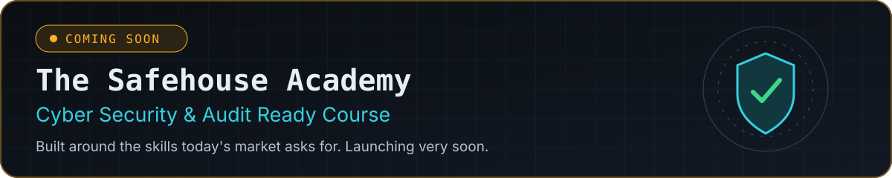</a></p>

> 🎓 **The Safehouse Academy is launching soon** with a **Cyber Security &amp; Audit Ready Course** — built around the skills today's market asks for. Follow [The Safehouse](https://www.thesafehouse.in) for the launch announcement.

| Website | Explore |
| :--- | :--- |
| 👤 [Amit Ambekar Portfolio](https://portfolio.thesafehouse.in) | Career experience, security expertise, certifications, projects, and contact details<br/><sub>🛠️ Next.js · TypeScript · Vercel</sub> |
| 🏠 [The Safehouse](https://www.thesafehouse.in) | Organizational security awareness and personal digital safety services<br/><sub>🛠️ Next.js · TypeScript · Vercel</sub> |
| 📰 [The Safehouse Journal](https://blog.thesafehouse.in) | Practical cybersecurity articles, topic tags, and reading series<br/><sub>🛠️ Next.js · MDX · Vercel</sub> |
| 🎓 [The Safehouse Academy](https://www.thesafehouse.in) — *coming soon* | Cyber Security &amp; Audit Ready Course<br/><sub>🚀 Launching soon</sub> |

**Interactive project demos** *(hosted on GitHub Pages)*

| Demo | Explore |
| :--- | :--- |
| 🗓️ [ShiftGuard Studio](https://amitambekar510.github.io/ShiftGuard-SOC-Roster-Management/) | Build and review a synthetic SOC roster in the browser |
| 🧱 [SIEM Dashboard Showcase](https://amitambekar510.github.io/siem-dashboard-framework/) | Explore the dashboard designs with synthetic demo data |
| 📘 [SOC Operations Handbook](https://amitambekar510.github.io/soc-operations-handbook) | Read the handbook online |

## Threat intelligence feeds

Explore the repositories for feed files, collection logic, usage guidance, and update history.

| Intelligence | Repository | Latest repository commit |
| :--- | :--- | :--- |
| 🌐 **IP addresses** | [Malicious IP Threat List](https://github.com/amitambekar510/Malicious-IP-Threat-List) |  |
| 🔗 **Domains** | [Malicious Domain Threat List](https://github.com/amitambekar510/Malicious-Domain-Threat-List) |  |
| 🔐 **File hashes** | [Malicious Hash Threat List](https://github.com/amitambekar510/Malicious-Hash-Threat-List) |  |

*Commit badges show repository activity, not feed validation or availability. Validate indicators in your environment before enforcement.*

## Security toolkit

| Area | Focus |
| :--- | :--- |
| **Threat intelligence** | IOC enrichment, reputation analysis, OTX, VirusTotal, AbuseIPDB |
| **Detection & investigation** | Elastic / ELK, Splunk, MITRE ATT&CK, investigation playbooks |
| **Endpoint & network security** | CrowdStrike, SentinelOne, FortiGate |
| **Automation & infrastructure** | Python, GitHub Actions, Docker, Linux |
| **AI-assisted operations** | OpenCode, Nemotron, CTI prompt workflows |
| **AI-ready frameworks** | Guided AI workflows for reporting, rostering, SOC handbooks, and SOC learning paths |
| **Governance interests** | Information security, privacy, AI governance, security documentation |

## Credentials and learning

<details>
<summary><strong>View certifications and training</strong></summary>

| Certification | Issuer |
|---------------|--------|
| **Certified Information Security Manager (CISM) — Certified 2026** | ISACA |
| **Certified Ethical Hacker (CEH)** | EC-Council |
| **Certified Incident Handler (CIH)** | EC-Council |
| **ISO/IEC 27001:2022 Lead Auditor** | Mastermind |
| **ISO/IEC 27701:2025 Lead Auditor** | Mastermind |
| **ISO/IEC 42001:2023 Lead Auditor** | Mastermind |
| **Cyber Threat Intelligence 101** | ArcX |
| **Certified Network Security Practitioner (CNSP)** | The SecOps Group |
| **Certified Cloud Security Practitioner (CCSP)** | The SecOps Group |
| **Certified AppSec Practitioner (CAP)** | The SecOps Group |
| **Certified AI Agent Security Specialist** | Proofpoint |
| **SailPoint Identity Security Leader** | SailPoint Technologies |
| **FALCON 101: Falcon Platform Essentials** | CrowdStrike University |
| **OT Security Expert (OOSE)** | OPSWAT Academy |
| **Seceon OTM Advanced & Foundation** | Seceon |
| **PCI DSS Awareness** | TÜV SÜD |
| **Microsoft Technology Associate** | Certiport |

</details>

<details>
<summary><strong>View education, recognition, and current learning</strong></summary>

| Education | Institution | Year |
| :--- | :--- | :--- |
| PGDBM in IT & Systems Management | Narsee Monjee Institute of Management Studies, Mumbai | 2025 |
| Cyber Law | Symbiosis Centre for Distance Learning, Pune | 2021 |

**Recognition:** Best Employee of the Month, Most Promising Newcomer, and Bright Beginner Award at Audix Techno Consulting Solutions.

**Industry participation:** Event exhibitor and representative for Comtel Infosystems Private Limited.

</details>

<p align="center"><a href="https://portfolio.thesafehouse.in"></a></p>

## Writing and collaboration

I share practical security knowledge and welcome conversations about **threat intelligence, SOC tooling, detection use cases, and security automation**.

- **Read:** [The Safehouse Blog](https://blog.thesafehouse.in) · [Medium](https://medium.com/@amitambekar510) · [DEV Community](https://dev.to/amit_ambekar_c022e6732f8d)
- **Explore intelligence:** [My AlienVault OTX pulses](https://otx.alienvault.com/user/amitambekar/pulses)
- **Connect:** [LinkedIn](https://www.linkedin.com/in/amitmilindambekar/) · [Email](mailto:amit.ambekar@protonmail.com)
- **Contribute:** Open an issue or pull request in the relevant project with your improvement or feedback.
- **Learn with me (coming soon):** [The Safehouse Academy](https://www.thesafehouse.in) — Cyber Security & Audit Ready Course.

---

<p align="center"><strong>Defending networks, one indicator at a time.</strong><br />Amit Ambekar · <a href="https://www.thesafehouse.in">The Safehouse</a></p>
